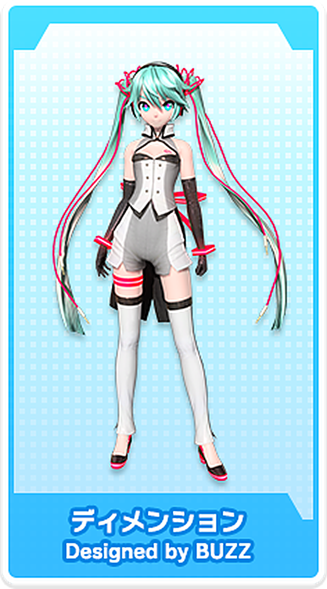

# dsh-miku — 初音未来侧边栏背景

**一句话价值**：安装后，DSH 左侧菜单背景会显示《初音未来 Project DIVA Future Tone》的官方模组立绘——每个会话绑定一张卡片，或固定使用你挑选的一张，并可用滑块调节不透明度。



## 安装

```bash
dsh plugin --profile web add github:Qquanwei/dsh-miku
```

也可以在 GUI 的 **Plugins → Add plugin** 中添加本仓库，或把市场索引
`https://raw.githubusercontent.com/Qquanwei/dsh-miku/main/market/index.json`
加入插件市场索引源后从 Discover 安装。（尚未发布 NPM 包，故使用源码安装命令。）

## 功能与设置

打开 **设置 → 插件 → 初音未来背景**：

- **根据会话自动切换**：会话 id 哈希稳定绑定一张卡片，切换会话即换卡；
- **使用固定图片**：168 张模组卡片分页网格（每页 24 张）点选；
- **不透明度滑块**：5%–100%，即时生效，兼顾背景与文字可读性。

## 兼容与运行要求

- DSH 0.2.x（在 0.2.2-rc.3 桌面版实测）；Web / 桌面（macOS、Windows、Linux）均可；
- 纯 UI 装饰：运行时**无网络请求、无外部服务、不申请额外权限**；只读取自身配置与当前会话 id；
- 图片全部内置于仓库 `assets/`（WebP，约 2.7 MB），离线可用。

## 许可证

- **代码**：MIT。
- **图片**：模组立绘版权归 © SEGA / © Crypton Future Media, Inc. 所有，来源为官方模组页
  <https://miku.sega.jp/FT/cht/module/>，本仓库仅作个人学习/装饰用途收录。**请勿将含图片的副本用于商业再分发**；如需商业使用请自行取得授权或替换图片。

## 能力分类

界面与体验（装饰类）。

## 开发说明

- Host 端 `index.js` 导出 `apply(ctx)`，声明 `mode / fixedImage / opacity` 三个 volatile 配置；
- Client 端 `client.js` 通过 `ctx.configForms` 读写配置、`ctx.uiSession` 订阅当前会话，
  以 `::before` 伪元素绘制背景，并向 `settings.plugins.tab` 注册设置页；
- 本地 link 安装时 `@deepseek-ai/schemastery` 需可解析（仓库已声明为 npm 依赖，git/NPM 安装会自动拉取）。
